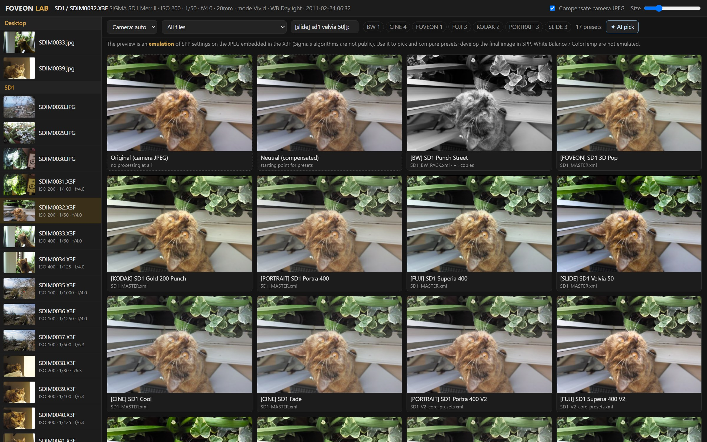

# Foveon Lab

For Sigma Foveon **X3F** files of every generation: **match Sigma Photo Pro (SPP), then outmatch
it**, and a **complete film simulator** — films, developers and papers from the makers' own data,
on the sensor that comes closest to film. General editing is left to other tools through the DNG
export. Everything is measured against SPP and from first principles; the mission, principles and
goals (with where we are) are in the [manifest](docs/MANIFEST.md).



- Scans your folders for `.X3F` files and shows each one at once from the **full-size JPEG embedded
  in it**, then from its **raw data** (native Go decoder for every generation, SD9 to Quattro).
- **Presets from three places:** your own preset folder, a **built-in pack of ~290 SD1/SD15
  presets** (base, negative/slide/portrait film looks, cine, B&W, white balance, scene), and the
  presets you saved in SPP itself (Windows). Comma or dot decimals; identical duplicates folded.
  Filter by camera, `[GROUP]` tag, file or name. Film-look presets are named after the film
  they imitate with SPP settings; the physically simulated films are in Film stock.
- **Grid view:** one photo through every preset at once. Click a tile for a large view with sliders;
  `←`/`→` steps through presets, hold `O` for the camera original.
- **Distinct looks:** many presets are near-copies (V2/V3 of one idea, SD1/SD15 twins). This renders
  them all on *your* photo, groups the ones you couldn't tell apart, and shows one tile per look
  (e.g. 184 SD1 presets → ~50 looks), with **+N similar** to open a group.
- **Editor tools:** before/after **Split** (`S`, follow the mouse), an RGB histogram, the share of
  clipped highlights / crushed shadows, and **Clipping** marks on the photo (`C`).
- **Save as preset** writes an SPP-importable XML (`FoveonLab_SD1.xml` / `FoveonLab_SD15.xml` in the
  presets folder; saving the same name replaces it instead of duplicating).
- **Export** next to the photo, in a `foveon-lab/` folder:
  - **JPEG** — full resolution, preset applied;
  - **TIFF 16-bit** — full resolution, preset applied, no 8-bit rounding (Deflate-compressed RGB, no
    alpha) for further editing in Photoshop, Affinity, GIMP…;
  - **DNG (raw)** — the X3F's raw data as a DNG 1.4 with colour matrices, for Lightroom / Capture
    One / darktable (any Foveon body). A raw file can't carry the preset, so a **`.cube` LUT of the
    preset** is written next to it;
  - **LUT (.cube)** — any preset or tuned look as a 33³ 3D LUT for darktable (*lut 3D*),
    Photoshop (*Color Lookup*), Camera Raw / Lightroom (via a profile made in Camera Raw), DaVinci
    Resolve, Affinity… Apply it to a neutral rendering. It is the preview's own per-pixel maths
    (within 0.5/255 of the preview); Fill Light becomes a global shadow lift and Sharpness is left out.
- **Batch export:** one preset (or your tuned settings) on a whole folder or every photo, as JPEG or
  16-bit TIFF.
- **Calibration tools** measure what SPP actually does, to replace guesses with measured curves (below).

Single Go binary, no runtime dependencies, runs locally on `127.0.0.1` only.

## Download

Grab the file for your system from the **[latest release](https://github.com/biopoetic/foveon-lab/releases/latest)**,
nothing else needed:

| System | File |
|---|---|
| macOS (Apple Silicon and Intel) | `Foveon-Lab-….dmg` → open it, drag **Foveon Lab** to Applications |
| Windows | `foveon-lab-…-windows-x64.zip` → unpack, double-click `foveon-lab.exe` |
| Linux | `foveon-lab-…-linux-x64.tar.gz` → unpack, run `./foveon-lab` |

It opens in your browser; **Folders…** picks where your photos and presets are, **Quit** stops it.
Starting it again while it runs just reopens the browser tab. The Windows build is
Authenticode-signed; the Mac app is signed with a Developer ID, notarized and stapled by Apple.
The `macos-*.tar.gz` archives hold the plain command-line binaries.

**Updates:** from v0.3.0 on, Foveon Lab checks GitHub for a newer release (twice a day) and shows
**Update & restart** in the top bar. It downloads only files listed in a manifest signed with the
project's Ed25519 key, checks their SHA-256, swaps them in place and restarts on the same address.
Nothing is installed without your click; set `FOVEON_NO_UPDATE=1` to turn the check off. On macOS
the app has to be in Applications (not run from the disk image) to update itself.

Releases are cut locally with `go run ./tools/release -version vX.Y.Z -publish` (signing keys never
leave the maintainer's machine; it refuses to publish unsigned binaries).

### Build from source

```
go install github.com/biopoetic/foveon-lab@latest
```

or clone and `go build -o foveon-lab.exe .` (Go 1.25+).

## Usage

```
foveon-lab                       # scans your Desktop, presets from "Desktop/foveon pack", opens the browser
foveon-lab -photos "D:\Photos;E:\Sigma" -presets "D:\SPP presets" -port 8777 -no-open
```

Photos are found up to 4 levels below each `-photos` folder.

## Open in Sigma Photo Pro (Windows, SPP 6)

**Open in SPP ↗** in the editor hands the current preset straight to SPP: it adds it to SPP's preset
list, makes it SPP's current adjustment and launches SPP on the photo — no XML import step.

How it works: SPP keeps no per-photo edits. Its preset list is
`%LOCALAPPDATA%\SIGMA\SIGMA_PhotoPro6\X3F_Setting.xml` and its current adjustment is the `X3F_*` keys in
`SPhotoPro.xml` there. Foveon Lab edits both **only while SPP is closed** (SPP rewrites them on exit),
backs them up first to `foveon-lab-backups\` next to them (last 10 kept), and prefixes everything it
writes with `[FL]` so your own SPP presets are never overwritten. Your X3F files are never modified.
Black & white presets (the packs mark them with Saturation −1, or tick **Monochrome** in the editor)
are handed over with Saturation −2: in SPP −1 is only muted colour, −2 is fully grey. (SPP's separate
Monochrome mode can't be used — SPP always opens photos in Color mode, whatever its saved
`X3F_FilterMode` says.)
If SPP is already open, Foveon Lab offers to close it the normal way (a window close, never a forced
kill — SPP can still ask about unsaved work) and reopen it with the preset.

## AI agent: pick and tune a preset for you

Click **✦ AI pick** (grid) or **✦ AI** (editor). A vision model looks at the photo, shortlists presets
by rendering them on it, compares the renders (each comes with objective stats: clipping, crushed
shadows, brightness, saturation, warmth), fine-tunes the best one, and explains its choice. You watch
every step live, then **Open in editor** to save it as an SPP preset or export it. You can give it a
direction, e.g. *"warm film look"*, *"moody"*, *"natural skin"*. **Whole folder** makes it judge a
contact sheet of up to 6 photos from the folder and pick one look for the whole series (then use
**Batch export…**).

**Connect a provider in the app:** open the AI panel, pick **DeepSeek**, **OpenAI**, **Google
Gemini**, **OpenRouter** or any other OpenAI-compatible API (it must accept images and tool calls),
paste your API key and click **Test & save**. Foveon Lab checks the key with one tiny request before
saving it. The key stays in Foveon Lab's settings file on your computer and is sent only to the
provider you chose; **Remove key** deletes it. You pay the provider directly.

Alternatively set an environment variable (used when nothing is saved in the app):

```
set DEEPSEEK_API_KEY=sk-...          # Windows (export ... on macOS/Linux)
foveon-lab -ai-base https://api.openai.com/v1 -ai-model <vision model> -ai-key-env OPENAI_API_KEY
```

- Downscaled renders of the photo (≤ 768 px) are sent to the model provider.
- A run is typically 4–8 model calls, ~60–100k input tokens — about 1–2 US cents on DeepSeek
  (September 2026 pricing).
- The agent judges the emulated preview, so its choices inherit the emulation's limits (see below).

## Limitations — read this

- **The preview is an emulation, not SPP** — but a **measured** one. Sigma's algorithms are not
  public, so every slider was measured in SPP 6.9 itself (see *Calibration* below): its effect on
  brightness and colourfulness, and for X3 Fill Light on each pixel *and its surroundings*. On the
  measurement photo (SD1 Merrill) the preview is now within ~1–2/255 of SPP for Exposure, Contrast,
  Highlight, Shadow, Saturation and the colour modes, and ~4–7/255 for Fill Light (was 10–33 with
  the earlier hand-written formulas). Held-out settings, predicted by interpolation, land within the
  same range. Measured on one SD1 photo so far; SD15 files may differ slightly. Develop final images
  in SPP.
- **Where the preview starts.** The camera's own JPEG already has the in-camera colour mode applied
  (Vivid, FC Blue…), so even before any preset it differs from SPP's neutral rendering — measured on
  13 photos: about 17–21/255 on average, up to 40 for FC Blue shots. "Compensate camera JPEG" undoes
  part of that from the X3F metadata. **Accurate** (on by default) does better for **SD1 Merrill, DP
  Merrill and SD15** files: it starts from the raw data (decoded natively, no external tools) mapped onto SPP's neutral
  look — on photos the mapping was not fitted on: **SD1 3.97/255, DP Merrill 4.21, SD15 6.03**, vs
  ~17–21 for the camera JPEG. The first view of a photo shows the JPEG at once and swaps in the
  accurate preview when the raw decode is done (cached). A damaged embedded JPEG falls back to the
  raw data.
- **ColorMode codes**: all measured in SPP. 4 = Standard, 6 = Portrait, 7 = Landscape; 5 and 8 are
  two further looks (8 is more saturated with hue shifts); 0–3 and 9–12 all render like one default
  mode. Each is emulated within ~1–2/255.
- **White Balance** is emulated as measured in SPP: in presets, WhiteBalance 0 and 1 look the same,
  2 and 6 shift colour strongly (both measured, now within ~2–3/255). **ColorTemp** stored in a
  preset has no visible effect in SPP at all (3000/5000/7000 K exported identically), so it is
  only kept and written back.
- **Whole presets** (six real ones from the pack, many sliders at once) land within **2.7–6.5/255**
  of SPP when starting from SPP's own neutral rendering; the largest share is X3F Fill Light, whose
  local behaviour is modelled only approximately.
- **Cameras:** tested on files from the SD9, SD10, SD14, SD15, SD1 Merrill, DP1, DP1 Merrill,
  dp2 Quattro, DP0 Quattro, sd Quattro and sd Quattro H. Merrill bodies get the SD1 presets,
  SD14/DP1/DP2 the SD15 presets (same sensor generations).
- **SD9 / SD10** carry no full-size preview. Foveon Lab decodes their raw data at full resolution
  itself (a Go port of [x3fuse-core](https://github.com/sagwaco/x3fuse-core)'s decoder). A raw
  decode has no in-camera look, so it starts more neutral than the JPEG-based previews of the
  other bodies.
- **Raw DNG** export works for every body, Quattro included, without external tools.

## Calibration: measuring SPP instead of guessing

```
foveon-lab calibrate -spp   # creates Desktop/foveon-calibration and adds the [CAL] presets to SPP
foveon-lab analyze          # measures the exports → report.txt, calibration.json, model_<photo>.json
foveon-lab fit-raw          # from <photo>_A00.tif exports: fits + tests the raw base per camera → rawbase.json
foveon-lab calibrate -auto -photo SDIM0260 -steps A,W   # Windows: drives SPP itself to make the exports
```

**`-auto`** does the exporting for you: open the photo in SPP, run it, and don't touch mouse or
keyboard — it picks each `[CAL]` setting in SPP's list, presses Ctrl+S and fills in SPP's "Save Images
As" dialog (about 40 s per export, existing files are skipped). `model_<photo>.json` is the measured emulation; copy it to `render/model.json` and rebuild to use it
(the shipped one was measured on an SD1 Merrill photo). Each `[CAL]` preset moves exactly **one** SPP control to a known value (e.g. Contrast +0.5); everything
else matches the neutral preset `A00`. You apply each preset in SPP to the same photo and save it as
`<photo>_<code>.tif`. `analyze` then compares every export with SPP's own neutral `A00` export and
reports, per control:

- the tone curve (output vs input brightness),
- the saturation gain,
- a 3×3 linear colour matrix (for colour modes and colour adjust) and its fit error,
- whether it acts locally (Fill Light) — brightness shift by pixel vs. surrounding brightness,
- **how far this project's emulation is from SPP** for the same setting.

`calibrate` also suggests good calibration photos from your library (wide tonal range, colour,
little clipping). This is black-box measurement of SPP's output; nothing is decompiled.

## Project layout

| Path | What |
|---|---|
| `x3f/` | X3F container: section directory, embedded JPEGs, PROP metadata |
| `preset/` | SPP preset XML reading/writing |
| `render/` | linear-light float pipeline emulating the SPP sliders |
| `calib/` | calibration preset pack, export analysis, source-photo suggestions |
| `agent/` | vision-model agent loop (tools: `render_presets`, `render`, `finish`) |
| `spp/` | hand-off to an installed Sigma Photo Pro 6 (preset list + current setting) |
| `web/index.html` | the UI (embedded into the binary) |

```
go test ./...
```

Tests that use real X3F files or preset folders skip themselves when those are not on the machine.

## Contributing

Issues and pull requests are welcome — especially calibration results (`report.txt`) from SPP, and
X3F samples from other Foveon cameras.

## Third-party software, and what is ours

**Ported.** X3F is an undocumented format; what is known about it comes from the people who
reverse-engineered it. Reading it is therefore a port: the `x3f` package's raw decoder
(`raw.go`), CAMF reader (`camf.go`), spatial gain (`sgain.go`), bad pixel lists (`badpix.go`) and
Quattro layer expansion (`quattro.go`) are Go ports of **x3fuse-core** (© 2026 Sang Lee, Apache
License 2.0), which in turn comes from the Kalpanika x3f tools (© 2015 Roland Karlsson, Erik
Karlsson, Mark Roden; BSD-style). The knowledge of the X3F format is theirs. Their licenses and
notices in `third_party/x3fuse-core/` apply to these files and ship with every release.

**Data.** The infrared looks' lens filters are real SCHOTT filter glasses (OG590, RG715);
their transmission curves are SCHOTT's published internal transmittance and reflection factor
(shop.schott.com, fetched October 2026), kept in `render/schottglass.json`. SCHOTT is a
trademark of SCHOTT AG; Foveon Lab is not affiliated with it.

**Foveon Lab's own work** — everything done with the image once it is read:
- the Foveon noise reduction (`denoise.go`), built on the three layers' different noise and a
  noise model measured on each photo. (An earlier claim that it beat SPP's own, ISO 6400 dE 6.6
  vs 18.1, rested on a measure that rewards smoothing; side by side, SPP keeps more texture and
  sharpens. Withdrawn 2026-10-14 until a fair comparison is done.);
- the X3F encoder (`encode.go`), which writes files back byte-identically, and the recovery of
  damaged files;
- a floating-point pipeline that keeps the noise below black, and neutral clipped highlights;
- the Sigma Photo Pro emulation: presets, colour modes, the raw-to-SPP calibration measured
  against SPP exports and synthetic test charts, and the raw DNG export with the camera's colours.

## Legal

MIT licensed — see [LICENSE](LICENSE).

Film names (Kodak, Portra, Ektar, Gold, Ultramax, Ektachrome, Tri-X, T-Max; Fujifilm, Fujichrome,
Fujicolor, Velvia, Provia, Astia, Superia; Ilford, HP5, FP4, Pan F, Delta, Multigrade; Agfa, APX and
others) are trademarks of their owners. Foveon Lab is not affiliated with or endorsed by them: presets
named after a film imitate its look with SPP settings, and Film stock simulates films from the makers'
published data.

Sigma, Foveon, X3F and Sigma Photo Pro are trademarks of SIGMA Corporation. This is an independent
project, not affiliated with or endorsed by SIGMA Corporation. It reads the documented-by-the-community
X3F container format and never modifies your original files.
